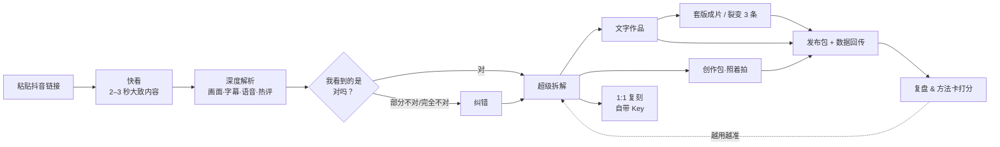
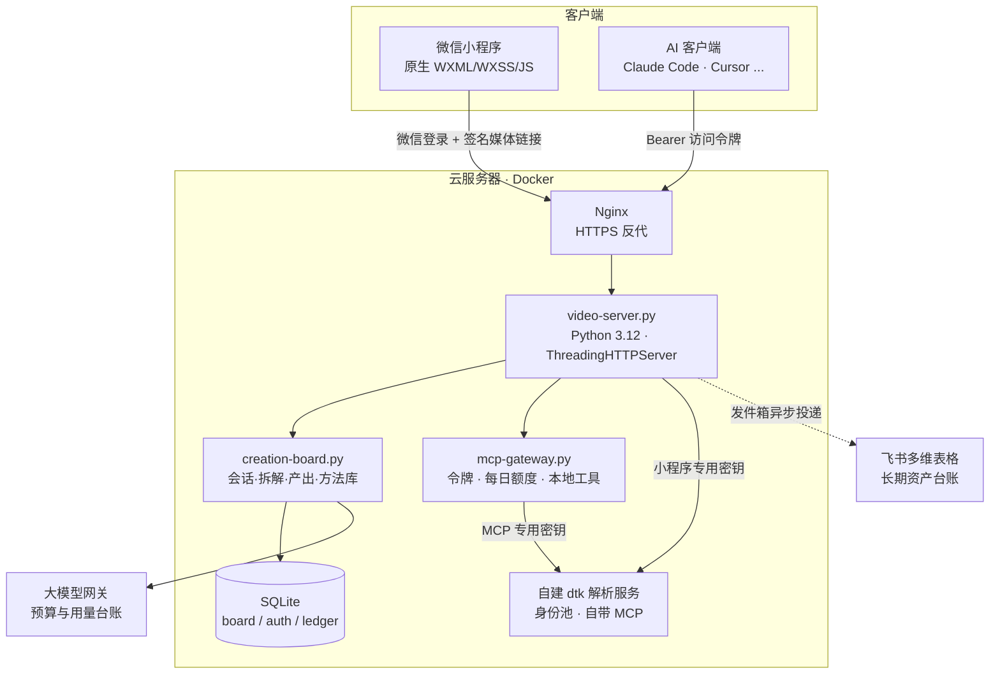

<div align="center">

# 有AI · YOUAI

**粘贴一条抖音链接，看懂爆款、拆出方法、写出你自己的版本。**

一个面向短视频创作者的 AI 微信小程序，附带一个可供 Claude / Cursor 等 AI 客户端直接调用的远程 MCP 抖音解析下载服务。

[](https://developers.weixin.qq.com/miniprogram/dev/framework/)
[](scripts/Dockerfile.video)
[](#-测试与开发规范)
[](#-远程-mcp抖音解析与下载)
[](compose.video-cloud.yml)
[](#-许可证)

[功能](#-功能亮点) · [工作流](#-工作流) · [架构](#-架构) · [MCP 接入](#-远程-mcp抖音解析与下载) · [快速开始](#-快速开始) · [目录](#-目录结构) · [文档](#-文档索引) · [路线图](#-路线图)

</div>

---

## 📖 简介

做短视频时，最难的往往不是剪辑，而是**看懂一条爆款为什么火，并把它变成自己的内容**。有AI 把这件事拆成一条连续的流程：

> 粘贴链接 → 2–3 秒看到大致内容 → 深度解析画面、字幕和语音 → 你确认或纠正 AI 的理解 → 按拆解方案做「超级拆解」→ 生成文字作品 / 创作包 / 成片 → 发布后回传数据 → 复盘，方法卡越用越准

AI 负责看、拆、写初稿；**每一步的决定权都在创作者手里**：理解不对可以纠正，拆法可以调整，文案可以逐句改。

## ✨ 功能亮点

| | 能力 | 说明 |
|---|---|---|
| ⚡ | **秒级快看** | `POST /references/peek` 解析链接与封面文案，新链接约 2.4 秒给出大致内容，完整解析在后台继续 |
| 🔍 | **深度理解** | 关键帧抽取 + 本地 OCR（RapidOCR）+ 语音转写（faster-whisper）+ 多模态模型，区分全程大标题与时间轴字幕 |
| ✅ | **人在回路** | 「我看到的是」确认卡：对 / 部分不对 / 完全不对，纠错进入后续所有产出 |
| 🧩 | **超级拆解** | 按可自定义的「拆解方案」逐字段输出结论、怎么学、结构、评论区打法；热评按 `赞 + 3×回复` 加权分层 |
| ✍️ | **文字作品** | 按原作结构与口吻逐句改写，给出发布正文、3 个标题、封面大字与话题；与原文太像会标红，避免被判搬运 |
| 🎬 | **创作包与成片** | 逐镜头拍摄清单、提词器；上传自己的画面一键叠字幕成片 |
| 🧬 | **裂变 3 条** | 同一段画面配 3 版开头钩子不同的文案，依次合成，便于批量发布和 A/B 测试 |
| 🔁 | **方法卡复用** | 每次拆解按类目沉淀「可学方法」，生成时优先参考同类高频、数据好的方法；发布数据回流后给方法打分 |
| 🎥 | **对照原视频** | 生成结果旁附 360p 压缩原片（首次生成后复用），边看边改 |
| 🤖 | **远程 MCP** | 让 Claude、Cursor 等 AI 客户端直接解析和下载抖音作品，独立密钥、独立额度，不占小程序资源 |
| 📊 | **额度与中台** | 每用户每日新视频数、全站日预算、额度申请；管理中台可调参数与查看看板 |
| 🔐 | **隐私优先** | 采集声明与隐私说明逐字一致并有测试守护；自带 Key 不落盘、评论者身份不保存 |

## 🧭 工作流



## 🏗 架构



- **单进程服务**：`scripts/video-server.py` 按需加载同目录模块（看懂视频、OCR、热评、链接识别、登录、复刻、灵感箱、台账等），无外部框架依赖。
- **两把解析密钥**：小程序与 MCP 在 dtk 中各用一把密钥，分开限流、分开记账，互不挤占。
- **资产按 sha256 去重**：参考视频、压缩预览、成片统一存储，媒体链接按用户签名、限时有效。

## 🔌 远程 MCP：抖音解析与下载

服务地址：`https://youai888.top/youai/mcp`（Streamable HTTP）。需要维护者发放的访问令牌，**仓库内不含任何令牌或密钥**。

| 工具 | 作用 |
|---|---|
| `download_video` | **服务器托管下载**：解析分享链接或整段分享文案，下载无水印视频（图文合成幻灯片视频），返回作品信息与 30 分钟有效的签名下载链接，无需登录或 Referer |
| `parse_url` | 解析分享链接 |
| `get_video` | 作品详情 |
| `get_user` · `list_user_posts` | 作者信息与作品列表 |
| `list_comments` | 作品评论 |
| `pool_status` · `get_task_result` | 解析服务状态、异步任务结果（不计额度） |

<details>
<summary><b>客户端配置示例</b></summary>

**Claude Code**

```bash
claude mcp add --transport http youai https://youai888.top/youai/mcp \
  --header "Authorization: Bearer <TOKEN>"
```

**Cursor 及其他使用 JSON 配置的客户端**

```json
{
  "mcpServers": {
    "youai": {
      "url": "https://youai888.top/youai/mcp",
      "headers": { "Authorization": "Bearer <TOKEN>" }
    }
  }
}
```

然后直接对 AI 说：「下载这个抖音视频：https://v.douyin.com/xxxx/」。

</details>

**限制**：每天 50 次（北京时间零点重置）+ 每分钟 10 次；超出时返回可读的工具错误。网关实现见 [`scripts/mcp-gateway.py`](scripts/mcp-gateway.py)，运维说明见 [docs/mcp-remote.md](docs/mcp-remote.md)。

## 🚀 快速开始

### 环境要求

- [微信开发者工具](https://developers.weixin.qq.com/miniprogram/dev/devtools/download.html)（运行小程序）
- Node.js 20+（前端与文档测试，`node --test`）
- Python 3.12 + ffmpeg（后端；也可直接用 `scripts/Dockerfile.video` 构建）
- 可选：自建 [Douyin_TikTok_Download_API](https://github.com/Evil0ctal/Douyin_TikTok_Download_API) 解析服务、大模型 API Key、飞书自建应用

### 1. 运行小程序

```bash
git clone https://github.com/JC2065/MCP-douyinvideo.git
```

用微信开发者工具导入项目根目录。`project.config.json` 中的 AppID 属于原作者，请换成你自己的 AppID 或使用测试号。

### 2. 本地启动后端（可选）

```bash
pip install pillow imageio-ffmpeg faster-whisper requests av jieba   # 主要依赖，完整列表见 scripts/Dockerfile.video
export YOUAI_ASSET_ROOT=./.data/assets YOUAI_TOOL_ASSET_ROOT=./.data/tools YOUAI_RENDER_ROOT=./.data/render
export YOUAI_REFERENCE_PARSER_URL=http://127.0.0.1:8000   # 你的 dtk 解析服务
python3 scripts/video-server.py                          # 默认监听 127.0.0.1:8765
```

不设置 `YOUAI_WECHAT_CONFIG` 时后端不启用微信登录，便于本地调试。小程序默认连接线上服务；在开发者工具中把本地存储 `youai.debug.local-backend` 设为 `true` 即可改连 `http://127.0.0.1:8765`（仅模拟器生效）。

完整依赖与生产部署见 [`scripts/Dockerfile.video`](scripts/Dockerfile.video)、[`compose.video-cloud.yml`](compose.video-cloud.yml) 和 [国内部署说明](docs/domestic-deployment.md)。

### 3. 跑测试

```bash
node --test tests/*.test.js                     # 前端、页面逻辑、文案守护、文档一致性
cd scripts && python3 -m unittest test-creation-board test-mcp-gateway   # 后端单测
```

## 📁 目录结构

```text
.
├── app.js / app.json / app.wxss   # 小程序入口
├── pages/                         # 页面：首页、爆款拆解(video)、作品面板、拆解方案、1:1 复刻、灵感箱 ...
├── components/app-navigation/     # 顶部导航 + 悬浮球（后台任务面板）
├── utils/                         # 页面逻辑模块（拆解页、看懂视频、额度、隐私声明 ...）
├── case-study/ study-20x/         # 案例学习分包
├── scripts/
│   ├── video-server.py            # 线上主服务
│   ├── creation-board.py          # 创作板块：会话、拆解、产出、方法库、额度
│   ├── mcp-gateway.py             # 远程 MCP 网关
│   ├── watch-flow.py · content-understanding.py · screen-text.py   # 看懂视频 / OCR / 转写
│   ├── asset-ledger.py            # 飞书长期资产台账
│   ├── admin-console.py           # 管理中台
│   ├── Dockerfile.video · deploy-delta.sh · remote-release.sh       # 镜像与发布
│   └── test-*.py                  # Python 单测
├── tests/                         # Node 测试（node --test）
├── backend/ web/                  # 早期多端数据中台与网页原型
├── deploy/                        # Nginx 等部署配置
└── docs/                          # 设计、方案、交接与测试记录
```

## 🧪 测试与开发规范

本项目由人与 AI（Codex、Claude）交替开发，所有改动都要过测试并记录批次：

- 每次改动只运行受影响范围的测试：`node --test tests/<相关文件>.test.js`（可指定多个文件），并更新相关测试。
- 每累计 5 次改动，汇总最近五次改动内容，合并去重并执行这些改动部位的测试。
- 每累计 10 次改动，汇总最近十次改动内容，运行一次 `node --test tests/*.test.js` 完整测试。
- 改动部位的测试与完整测试同时出现时，只执行完整测试。
- 每次批次的范围、结果与已知环境项记录在 [docs/test-batches.md](docs/test-batches.md)。

新协作者请先读 [项目地图](docs/PROJECT-MAP.md)（现状、目录、测试与发布、常见坑），再看 [AGENTS.md](AGENTS.md) 中的协作规则。

## 📚 文档索引

| 主题 | 文档 |
|---|---|
| 接手必读 | [项目地图](docs/PROJECT-MAP.md) · [协作规则](AGENTS.md) |
| 创作板块（当前主线） | [创作板块方案](docs/creation-board-plan.md) · [产出类型](docs/output-types.md) · [拆解质量](docs/breakdown-quality-2026-10-19-codex.md) |
| 产品与规划 | [产品方案](docs/product-plan.md) · [开发主导方案](docs/development-master-plan.md) · [云端创作与飞书资产路线](docs/cloud-creation-roadmap.md) |
| 数据与后端 | [多端数据中台设计](docs/backend-data-platform.md) · [Demo 后端数据设计](docs/demo-backend-data-design.md) · [视频资产契约](docs/video-asset-pipeline.md) |
| 平台与运维 | [远程 MCP](docs/mcp-remote.md) · [管理中台](docs/admin-console-guide.md) · [国内部署](docs/domestic-deployment.md) · [发布策略](docs/release-strategy.md) |
| 隐私 | [隐私与数据保存说明](docs/privacy-creation-board.md) |
| 历史 | [开发过程记录](docs/DEV-LOG.md) |

产品取舍：先完善灵感、创作、学习和“我的”，商家与金额功能暂缓，不建设商家撮合、订单与结算。

## 🗺 路线图

- [x] 秒级快看、深度解析、确认卡与纠错
- [x] 超级拆解、可自定义拆解方案、热评加权分析
- [x] 文字作品（含发布正文）、创作包、套版成片、裂变 3 条
- [x] 方法卡复用与数据回流打分
- [x] 飞书多维表格长期资产台账
- [x] 远程 MCP（解析 + 服务器托管下载）
- [ ] 额度审核页与微信订阅消息通知
- [ ] 飞书月度复盘仪表盘
- [ ] 预览视频在分析阶段后台预生成
- [ ] 面向外部开发者的一键自托管部署

## 🔒 安全与隐私

- 仓库不包含任何 API Key、访问令牌或数据库；所有凭据只存在于服务器受限文件与维护者本机。
- 用户自带的模型 Key（BYOK）不存储、不记日志；后台数据截图识别后不保存；评论者身份不保存。
- 发现安全问题请通过 GitHub Issues 联系维护者，请勿在公开 Issue 中贴出可利用细节。

## ⚖️ 使用声明

本项目仅用于学习研究，以及处理**你本人拥有或已获授权**的内容。请遵守抖音等平台的用户协议与著作权相关法律，勿将下载内容用于搬运、侵权或商业转售。

## 🙏 致谢

- [Douyin_TikTok_Download_API](https://github.com/Evil0ctal/Douyin_TikTok_Download_API)：自建解析服务与其内置 MCP
- [RapidOCR](https://github.com/RapidAI/RapidOCR) · [faster-whisper](https://github.com/SYSTRAN/faster-whisper) · [FFmpeg](https://ffmpeg.org/)
- 本项目在 [OpenAI Codex](https://openai.com/codex/) 与 [Claude](https://claude.com/) 的协助下开发

## 📄 许可证

暂未选择开源许可证，**保留所有权利**。你可以浏览和学习代码；如需复制、修改或再发布，请先联系作者。
