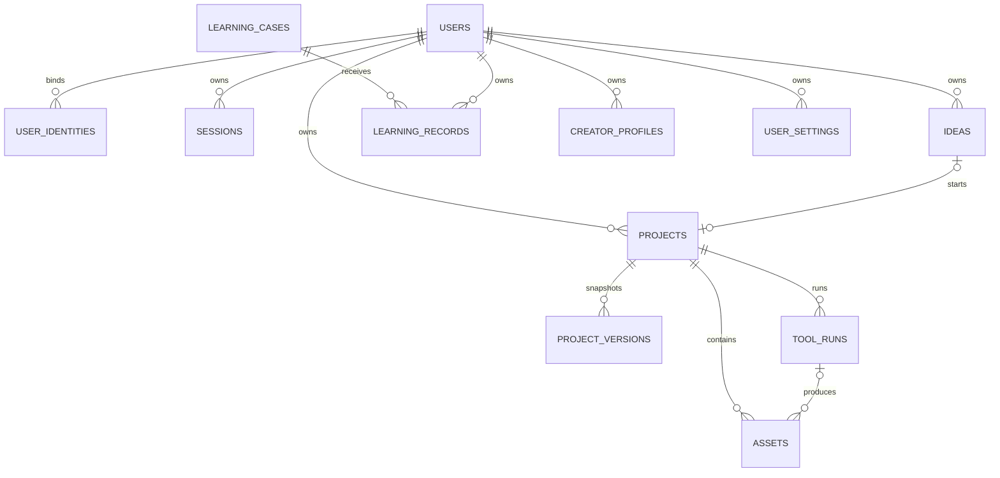

# Demo 后端数据设计基线

版本：1.0 · 日期：2026-10-10 · 对应功能：CORE-01、CORE-02、INS-01、CRT-01、LEARN-02、MY-01、MY-02。

本文从当前 `demo-v1.0` 的真实本机数据出发，回答“后端要保存什么、如何拆表、哪些先做、旧数据怎样迁移”。字段级机器清单见 [demo-backend-data-model.json](demo-backend-data-model.json)，总体服务边界见 [backend-data-platform.md](backend-data-platform.md)。

## 1. 设计对象

后端数据分为六组：账号与会话、灵感、创作项目、学习、个人设置，以及文件/工具/同步。商家、任务撮合、订单、预算、收益、支付和运营数据不进入本轮数据库。Demo 中已有的 `role`、`tasks`、`budget`、`earnings` 只属于历史演示数据，迁移时丢弃。

## 2. Demo 数据不能整包上传

当前 `youai-demo-v1` 把用户资料、灵感、作品、收藏和已延期业务混在一个对象中。服务端必须拆分：

| Demo 字段 | 后端目标 | 处理 |
| --- | --- | --- |
| `name` | `users.display_name` | 首次登录迁移，用户可修改 |
| `ideas[]` | `ideas` | 保留正文、创建时间及热点/案例/复盘来源 |
| `works[]` | `projects` | 一条作品变为一个项目，当前 `text` 作为可编辑草稿 |
| `works[].versions[]` | `project_versions` | 按原顺序生成不可变版本号 |
| `favorites[]` + `favoriteAt` | `learning_records` | 合并为每用户每案例一条状态 |
| `role`、`tasks[]`、`earnings[]`、`budget` | 无 | 属于延期业务，迁移时明确丢弃 |

创作档案和拆解偏好可以迁移。模型 Key、个人工具 Token 不自动上传，用户同意后重新录入服务端加密凭据。视频生成历史等阶段 D 再迁移；悬浮球位置只属于当前设备。

## 3. 关系模型

项目是创作主容器。灵感、案例、工具运行和素材都通过项目建立关系；历史版本只追加，不被草稿更新覆盖。来源同时保存稳定引用和最小快照，避免公共热点或案例改版后无法解释旧作品来源。

## 4. 通用字段与约束

所有用户内容表至少包含 `id`、`user_id`、`version`、`created_at`、`updated_at`、`deleted_at`：

- 离线可创建的资源由客户端生成 UUIDv7，服务端校验格式并以幂等键去重。
- 客户端不能提交 `user_id`；服务端从会话写入归属。
- 修改和删除必须提交期望版本，版本不一致返回 409 并附当前服务端副本。
- 删除先写墓碑，通过 `change_log` 同步到其他设备，再按保留策略物理清理。
- 所有时间在服务端保存 UTC；客户端只负责显示时区。
- `project_versions` 只允许新增；修订产生下一版本号。
- 密钥、Token、Cookie 和数据库连接不能进入 JSON 设置、内容表、日志或同步流。

## 5. 首批数据库范围

第一批迁移只创建 `users`、`user_identities`、`sessions`、`ideas`、`change_log`、`idempotency_keys`。它们足以完成阶段 A 的真实纵向闭环：微信登录 → 本机新增灵感 → 幂等上传 → Web 查看和修改 → 小程序增量拉取 → 冲突或删除正确同步。

`projects` 和 `project_versions` 在灵感闭环稳定后进入第二批；学习记录和个人设置进入第三批；文件、工具任务和加密凭据进入第四批。先建空表但没有真实调用不会提高完成度，因此不提前创建后续表。

## 6. 灵感首版字段

| 字段 | 用途 |
| --- | --- |
| `id` | 客户端生成 UUIDv7，断网时也能稳定引用 |
| `user_id` | 服务端从会话确定 |
| `text` | 1–4000 字，去除首尾空白后不能为空 |
| `tags` | 规范化、去重，首版最多 12 个 |
| `source_type` | `manual`、`hotspot`、`learning_case`、`review` |
| `source_ref` | 热点、案例、作品等来源标识，可空 |
| `source_snapshot` | 来源标题、平台等最小快照，不保存整份第三方内容 |
| `target_project_id` | 已带入的目标项目，可空 |
| `occurred_at` | 用户行为发生时间；同时保留服务端接收时间 |
| `version` / 时间 / 墓碑 | 并发和同步字段 |

列表默认按 `updated_at DESC, id DESC` 游标分页。首版支持正文和标签搜索，不为 Demo 的少量数据提前引入独立搜索服务。

## 7. 迁移流程

1. 登录后保留原本机 Key，生成迁移批次 ID 和内容摘要。
2. 按资源拆分并调用批量迁移接口，每条记录使用稳定幂等键。
3. 服务端返回本机旧 ID 与新 UUID 的映射，客户端修复作品来源、复盘和收藏关系。
4. 拉取服务端结果并核对数量、正文摘要和关联关系。
5. 标记迁移完成，但继续保留旧数据一个版本周期；确认恢复无误后再提示清理。
6. 任何失败只重试未确认项，不清空本机原数据。

没有 `createdAt` 的旧灵感不能伪造精确时间；记录 `occurred_at=null`，并保留迁移时间作为 `created_at`。明文个人密钥不随内容迁移，必须由用户重新确认录入。

## 8. 接口与异常状态

首轮需要 `/auth/wechat-mini/exchange`、`/auth/refresh`、`/auth/logout`、`/me`、灵感 CRUD、`/sync/operations` 和 `/sync/changes`。每项至少验证未登录、会话过期、空或超长正文、保留字段、重复创建、网络超时重试、两端版本冲突、双账号隔离和迁移中断续传。

## 9. 下一步实现顺序

1. 将字段清单转成 PostgreSQL `001_identity_and_ideas` 正向与回滚迁移。
2. 建立数据库约束、索引和仓储层，并复用现有领域合同测试。
3. 实现开发身份与微信身份交换，接口只从会话取用户。
4. 实现灵感 CRUD、幂等和变更流。
5. 给 Demo 增加只读迁移器和本机待同步队列，先做双写观察，再切换读取来源。
6. 使用两个账号、小程序和 Web 完成阶段 A 联调后，再设计项目表迁移细节。

这一顺序把数据库设计直接绑定到当前 Demo 的第一条真实跨端路径。新增字段必须能说明对应的用户行为、归属、生命周期和迁移方式。
