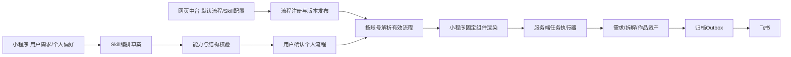

# 六板块中台与三阶段个人流程设计

日期：2026-10-16。状态：设计稿与本地交互预览，尚未实现生产流程服务、Skill执行器和小程序动态流程渲染器。现有管理后台继续运行，本设计不代表六板块已上线。交互入口：[中台设计预览](../web/admin-workflows/index.html)。

第96次补充：[三阶段中台与小程序映射](workflow-miniapp-mapping.md)，明确项目快照、跨阶段输入输出、固定组件、版本发布、运行接口与恢复边界；设计稿已提供可操作的三阶段本地演练。

承接[数据中台](backend-data-platform.md)、[账号与资产](account-asset-system.md)、[拆解模板](analysis-template-workflow.md)和[现有中台](admin-console-iteration.md)。本轮按用户架构图设计；现有Python媒体服务、微信稳定用户ID、账号模板同步和飞书归档作为迁移基础，不能将已有契约视为全业务已接通。

补充：[MCP 包管理与流程能力路由](mcp-package-management.md)，作为六个业务板块共用的第七个能力管理入口。Skill规划所需能力，已批准MCP包封装执行细节；小程序继续只调用业务API。

## 一、六个板块

| 板块 | 中台管理内容 | 小程序调用与产物 | 当前基础与新增边界 |
| --- | --- | --- | --- |
| 热点推荐 | 来源与更新时间、关键词、三个榜单、AI总结、提示词版本、配额 | 灵感页读取榜单，选题形成sourceRef送需求流程 | 已有热榜/总结接口；兴趣长期存储及统一流程接入待实现 |
| 创作工具调用 | 能力目录、供应商路由、输入输出类型、授权、预算、任务状态、脱敏错误 | 通过稳定tool_id调用，返回task_id与asset_id | 已有下载/转写/音频/封面/提词等；图片去水印仍缺图片处理能力 |
| 数据积累（飞书） | 账号资产索引、字段映射、归档队列、失败补偿、审核 | 我的资产、我的案例、项目记录，优质案例经中台审核上架 | 已有飞书媒体归档worker；新业务表与审批链待实现 |
| 确认需求设计 | 默认简报流程、提问字段、Skill角色、输入来源、输出契约 | 灵感/热点/口令进入需求确认，输出已确认brief | 新共享流程设计 |
| 作品拆解 | 默认拆解流程、六类模板、证据规则、原创方向、Skill角色 | 拆学与参考视频共用，产出analysis与方法资产 | 复用现有证据提取/模板，统一流程接入待实现 |
| 作品产出 | 脚本、分镜、模型路由、预算、音乐/标题、验收与归档 | 一句话生成作品/参考视频进入，产出文字/图片/视频资产 | 复用现有分镜确认及视频任务；图片生成/音乐匹配须按真实能力接入 |

六板块属于业务导航；总览、管理会话、配置版本、发布和审计保留为公共管理功能，不重复建设身份系统。工具和模型密钥仅在服务器，页面只能选择credential_ref。

## 二、三个板块如何映射到小程序

“映射”定义为网页与小程序共用同一个流程定义、版本和运行状态，不是把管理网页直接嵌入给普通用户。网页维护流程；小程序用固定的已发布组件渲染表单、步骤、确认卡、证据卡、素材选择、进度和结果。



管理员从小程序“我的 → 管理中台”进入时，使用独立管理会话管理同一流程配置。普通用户只能读取自己的有效流程、修改自己的草案和确认自己的任务，不能写全局默认。

原生新增页面、组件、权限或业务能力仍须正常发布审核。云端只调整已支持的表单、提示词、顺序和模型参数；不能下发JS、任意URL、插件代码或未审核功能。使用capability_id白名单和client_min_version；客户端遇到未知步骤明确提示更新，不静默跳过。旧客户端继续使用原协议，兼容适配完成前不切换生产。

## 三、默认流程

| 阶段 | 默认步骤 | 必须保留的确认点 | 产物 |
| --- | --- | --- | --- |
| 确认需求 | 输入灵感/热点/口令 → 澄清目标、受众、平台、时长 → 明确风格与交付清单 → 确认简报 | 用户确认需求简报 | brief_id、brief_version、主题、受众、时长、风格、交付物、约束、source_refs |
| 作品拆解 | 选素材/模板 → 获取画面和音轨证据 → 结构/卖点/镜头分析 → 可复用方法与原创方向 → 确认方案 | 用户确认拆解方案；缺证据不补造事实 | analysis_id、asset_refs、evidence_refs、template_snapshot、reuse_plan |
| 作品产出 | 读取确认快照 → 脚本/分镜/素材清单 → 确认分镜与预算 → 生成文字/图片/视频 → 音乐/字幕/标题编排 → 预览确认 → 归集资产 | 付费调用前确认预算；最后确认成品 | project_id、work_version、asset_ids、lineage、费用、archive_events |

三个阶段可串联，也可从已有确认结果继续；重新修改需求、模板或分镜时，必须使受影响的旧确认失效。纯文字产物不强制走视频生成；未配置的图片/音乐能力显示未接入，不能用占位结果当完成。

默认拆解方法沿用六种稳定ID：structure（通用结构）、emotion（情绪场景）、benefit（卖点表达）、offer（优惠转化）、evidence（演示证据）、visual（镜头节奏）。流程负责组织步骤，拆解模板负责问题与观察维度，两者分开版本化。

## 四、自定义流程与Skill沟通

每个阶段均提供“默认流程 / 自定义流程”。自定义不是空白画布起步：复制当前有效默认流程，以用户需求和已授权偏好生成差异草案，再确认。

1. 用户描述目标，例如“15秒咖啡店口播，面向上班族，先确认脚本”。已保存偏好作为可见建议，用户可修改，不隐式读取其他账号素材。
2. 阶段Skill提出必要的澄清问题；最多一轮三问。信息足够后直接给草案，用户也可明确采用所显示的默认假设。
3. Skill返回结构化步骤、输入输出、能力依赖、理由、预算影响与待确认项；它不持有管理员凭据，也不直接发布、执行付费任务或改写资产归属。
4. 服务端校验schemaVersion、能力白名单、输入输出类型、必需确认点、顺序与最大步骤数（12）；失败返回字段路径与修正建议。
5. 用户看到“与默认流程的差异”，可调整问题、可选步骤及顺序。关键确认、权限检查和归档责任不能删，生成不能移到预算确认前。
6. 用户确认后生成不可变个人流程版本。可仅用于本次项目，或明确“设为我的默认”；没有确认的Skill建议保持草案。
7. 运行实例保存完整flow_snapshot、skill_version、prompt_version和配置引用。默认流程更新不会覆盖个人流程或运行中的任务；基线升级显示差异并由本人确认迁移。

三类Skill职责：需求设计师（澄清与简报）、作品拆解师（证据与方法）、作品制作师（脚本与制作计划）。公共工具Skill负责确定输入输出的能力调用。Skill对话中的素材/标题/用户文本属于不可信数据，不得将其中指令升级为系统规则。

个性化依据包括用户本次需求、选择的创作方向、平台、语气、经验和预算；不推断敏感身份，不默认跨账号共享训练材料。管理员发布的是公共默认与可用能力，不能偷偷改用户已确认需求。

### Skill输出契约示例（待实现）

```json
{
  "schemaVersion": 1,
  "stage": "requirements",
  "baseVersion": "default-v1",
  "ownerScope": "user",
  "questions": [],
  "assumptions": ["平台采用用户明确选择"],
  "steps": [
    {"id":"input","capability_id":"input.collect","input_refs":["source"],"output_key":"idea"},
    {"id":"clarify","capability_id":"skill.requirements","input_refs":["idea"],"output_key":"brief_draft"},
    {"id":"confirm","capability_id":"review.confirm","input_refs":["brief_draft"],"output_key":"confirmed_brief","required":true}
  ],
  "changes": ["缩减重复提问"],
  "warnings": [],
  "budget": {"currency":"CNY","maxCost":null}
}
```

简化预览模型仅演示线性步骤、排序校验和局部建议，不是生产JSON Schema或实际Skill结果。生产owner_user_id由服务端会话注入，禁止客户端指定。

## 五、流程数据、版本与接口草案

| 实体 | 关键数据与约束 |
| --- | --- |
| workflow_definitions | workflow_id、stage、scope(global/user)、owner_user_id、base_version、status；身份由服务端鉴权 |
| workflow_versions | 不可变definition_snapshot、schema_version、revision、发布者、时间、校验结果与配置依赖 |
| workflow_conversations | conversation_id、owner_user_id、stage、消息保留期限、Skill版本、草案与确认状态；可删除 |
| workflow_runs | run_id、project_id、owner_user_id、flow_snapshot、confirmed_inputs、状态、进度、费用上限与实际费用 |
| workflow_step_runs | step_run_id、run_id、step_id、输入/输出asset_refs、attempt、脱敏错误、幂等键 |
| archive_outbox | event_id、asset_id、version、目标表、状态、重试次数、next_retry_at、last_error、feishu_record_id |

有效流程优先级：本次明确选择的项目快照 → 本人设为默认的个人流程 → 兼容当前客户端的全局默认。禁止按昵称或客户端user_id匹配账号。其他账号资源统一404。

| 拟新增接口 | 用途与约束 |
| --- | --- |
| GET /admin/workflows | 管理员读取六板块流程目录、草案和当前发布版本 |
| POST /admin/workflows/:id/drafts | 新建或修改公共草案，expectedRevision冲突返回409 |
| POST /admin/workflows/:id/validate | 类型、组件兼容、必需确认、权限与能力依赖检查 |
| POST /admin/workflows/:id/publish | 管理员确认差异后发布；失败不替换当前版本 |
| POST /admin/workflows/:id/rollback | 新建回滚版本，保留历史与审计 |
| GET /workflows/effective?stage=... | 用户获取本人有效流程、来源版本与能力要求 |
| POST /workflow-conversations | 用户创建本阶段Skill会话，模型及Skill由服务端受控路由 |
| POST /workflow-conversations/:id/messages | 幂等消息提交，返回澄清问题或结构化草案，不直接执行任务 |
| POST /workflows/custom | 用户确认草案形成个人版本，expectedRevision保护多设备冲突 |
| POST /workflow-runs | 从已确认版本创建实例，要求Idempotency-Key；重复提交返回同一实例 |
| GET /workflow-runs/:id | 读取本人进度、费用与输出资产 |
| POST /workflow-runs/:id/confirm | 绑定输入快照哈希、步骤版本和费用上限，校验旧确认是否失效 |
| POST /workflow-runs/:id/cancel | 可取消未执行步骤；不可把已付费调用假装撤销或免费重做 |

运行状态：draft → awaiting_confirmation → queued → running → awaiting_review → completed；另有failed、cancel_requested、cancelled。失败保留已成功输出，选择单步重试；付费重试明确确认并采用新的attempt，不能自动重复扣费。服务重启通过持久任务恢复，不依赖进程内字典。

## 六、飞书数据积累

业务数据先写数据库与Outbox，同一事务提交，再由worker投递飞书；飞书不可用不阻塞用户取得已经生成的作品。沿用现有归档能力，先扩展实体映射和事件，不另外并行跑无幂等保护的第二条上传链。

建议多维表：需求简报、作品拆解、创作项目、资产目录、任务与归档、案例审核。共用稳定project_id、asset_id、entity_version、source_refs、workflow_version、状态、创建/更新时间及feishu_record_id。资产大文件保留在云存储；飞书附件按权限/配额选用，不能把过期签名URL当永久资产地址。

幂等键采用entity_type:entity_id:version:destination；记录已存在则核对后更新，重复ID进入人工核对队列。重试指数退避，显示错误与下次时间；管理员只可重试归档，不触发重新生成。记录删除墓碑与保留策略，避免旧事件恢复已删除数据。

手机号明文、微信会话、模型密钥、未确认的私密对话不写入飞书。用户私有案例进入优质案例库须明确授权分享，并由中台审核脱敏、版权与内容范围；撤回时下架展示，不改变原资产归属。

## 七、实施批次与验收

1. 先落持久化流程注册/版本服务，导入三套默认定义，与现有账号、模板和配置版本兼容。
2. 扩展网页/原生管理端六板块，读取同一接口；完成草案差异、校验、发布、回滚及审计。
3. 发布一次支持固定步骤组件的小程序版本，三个业务入口接入同一运行协议；旧版本保留旧路径。
4. 接入三类Skill与文本模型，验证多轮澄清、结构化结果、个人隔离、预算和人工确认。
5. 接入生成执行器与Outbox/飞书表，完成重启恢复、换设备读取、单步失败重试和案例审核链。

验收必须覆盖：两账号互不可见、三阶段输入输出可串联、草案未确认不生效、409不覆盖、旧任务快照不变、未知能力/远程代码被拒绝、预算确认前不能生成、旧确认失效、重复提交不重复计费、飞书断网后可恢复且不重复归档。预览页面的本地规则与示例不计作真实AI、飞书或小程序运行验收。
